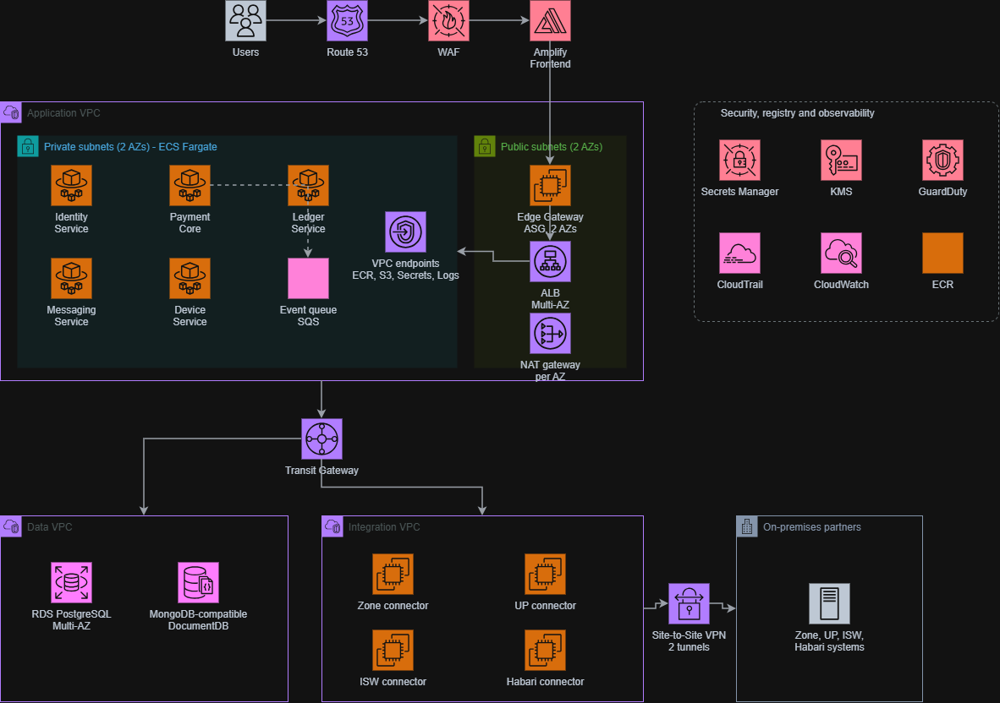

# AWS Application Architecture

## 1. Overview

This document describes the AWS infrastructure architecture for a distributed application platform. The architecture is designed to provide high availability, secure application hosting, scalable services, centralized monitoring, and private connectivity to external partner systems.

The infrastructure is organized into three Virtual Private Clouds (VPCs):

- **Application VPC:** Hosts application services and the application entry point.
- **Data VPC:** Hosts managed database services.
- **Integration VPC:** Provides connectivity to external integration services and on-premises partner systems.

An AWS Transit Gateway connects the VPCs, enabling centralized private network connectivity between the application, data, and integration layers.

## 2. Architecture Diagram

The diagram illustrates the application's request flow, application hosting environment, network topology, database layer, partner integrations, and security and observability services.

## 3. Request Flow

Incoming application traffic follows this general path:

1. **Users:** Users access the application through its public endpoint.
2. **Amazon Route 53:** Resolves the application's domain name to the appropriate endpoint.
3. **AWS WAF:** Inspects web requests and applies configured web application firewall rules to help protect against common web exploits and unwanted traffic.
4. **AWS Amplify Hosting:** Hosts and delivers the frontend application.
5. **Edge Gateway:** The gateway tier, deployed across two Availability Zones, provides the entry point into the application network.
6. **Application Load Balancer (ALB):** Distributes incoming application requests across configured backend targets.
7. **ECS Fargate services:** Run the application workloads inside private subnets across two Availability Zones.

The frontend communicates with the backend through the configured application entry point. Backend services process requests and interact with databases, queues, and external systems as required.

## 4. Application VPC

The Application VPC contains the application's compute and traffic-management components. It is divided into private and public subnets across two Availability Zones.

### 4.1 Private Subnets — ECS Fargate

The private subnets host the application services using Amazon ECS with AWS Fargate. Fargate provides managed container compute without requiring the team to manage the underlying container instances.

The application is divided into the following logical services:

| Service | Responsibility |
|---|---|
| Identity Service | Handles application identity-related operations. |
| Payment Core | Handles core payment processing and related business logic. |
| Ledger Service | Manages ledger-related operations and financial records. |
| Messaging Service | Handles application messaging and notifications. |
| Device Service | Handles device-related operations and integrations. |
| Amazon SQS | Provides asynchronous message queuing between application components. |

Services can be deployed and scaled independently according to their workload and operational requirements.

The diagram also shows a connection between the Ledger Service and the event queue, representing an asynchronous processing path. Other service-to-service communication paths should be defined according to the application's implementation.

### 4.2 Public Subnets

The public subnets contain the network components responsible for external traffic handling and outbound connectivity.

- **Edge Gateway Auto Scaling Group:** Runs the gateway tier across two Availability Zones. Auto Scaling can adjust capacity according to configured scaling policies.
- **Application Load Balancer:** Distributes requests across configured backend targets and supports health-based traffic routing.
- **NAT Gateway per Availability Zone:** Allows workloads in private subnets to initiate outbound connections to supported external endpoints without exposing those workloads directly to inbound internet traffic.

Deploying NAT Gateways across Availability Zones can improve availability and reduce cross-AZ routing when private subnet route tables use their corresponding NAT Gateways.

### 4.3 VPC Endpoints

VPC endpoints provide private connectivity to supported AWS services, reducing the need for application workloads to access those services through public endpoints or NAT Gateways.

The architecture identifies endpoints for:

- Amazon ECR — container image access.
- Amazon S3 — object storage access.
- AWS Secrets Manager — application secrets retrieval.
- Amazon CloudWatch Logs — application log delivery.

Endpoint types and policies should be configured according to the requirements of each AWS service.

## 5. Data VPC

The Data VPC isolates the database tier from the application and integration networks. It is connected to the wider environment through the Transit Gateway.

### 5.1 Amazon RDS for PostgreSQL

Amazon RDS for PostgreSQL provides the relational database layer.

The diagram specifies a Multi-AZ deployment to support database availability and managed failover in the event of an Availability Zone or database instance issue.

Recommended configuration includes:

- Private database subnets.
- Encryption at rest using AWS KMS.
- TLS for database connections.
- Security groups allowing access only from authorized application services.
- Automated backups and an appropriate retention period.
- Monitoring of database health, connections, storage, and performance.

### 5.2 Amazon DocumentDB

Amazon DocumentDB provides a managed, MongoDB-compatible document database for workloads that require document-oriented data storage.

It should be deployed in private subnets with appropriate encryption, network restrictions, backups, and monitoring.

The diagram does not specify the exact data ownership or usage split between PostgreSQL and DocumentDB. Those responsibilities should be documented separately based on the application's data model.

## 6. Integration VPC

The Integration VPC provides a dedicated network boundary for external integration components and partner connectivity.

The diagram identifies four integration components:

| Component | Purpose |
|---|---|
| Zone Connector | Provides connectivity to the Zone integration. |
| UP Connector | Provides connectivity to the UP integration. |
| ISW Connector | Provides connectivity to the ISW integration. |
| Habari Connector | Provides connectivity to the Habari integration. |

These connectors act as integration points between the application's internal services and external partner systems. Their specific protocols, authentication mechanisms, request formats, and retry policies depend on the relevant partner interfaces.

Keeping integration workloads in a dedicated VPC helps separate partner-facing connectivity from core application and database workloads.

## 7. Transit Gateway and Network Connectivity

AWS Transit Gateway serves as the central routing hub between the Application VPC, Data VPC, and Integration VPC.

This design avoids requiring every VPC to establish a separate direct connection to every other VPC.

The Transit Gateway enables private communication between authorized network segments, subject to route table configuration, subnet routes, security groups, and network access controls.

### Site-to-Site VPN

The Integration VPC connects to on-premises partner infrastructure through an AWS Site-to-Site VPN with two tunnels.

The external environment includes partner systems identified in the diagram as Zone, UP, ISW, and Habari.

The VPN provides encrypted connectivity between the AWS environment and the partner network. The two tunnels support VPN connection resilience, provided that routing and partner-side configurations are correctly implemented.

Network access should be restricted to the required partner IP ranges, ports, protocols, and application endpoints.

## 8. Security, Registry, and Observability

The architecture includes a shared set of AWS security, container registry, and monitoring services.

### 8.1 AWS Secrets Manager

Secrets Manager stores sensitive application configuration, such as database credentials, API credentials, and integration secrets.

Application workloads should retrieve secrets using task IAM roles and least-privilege permissions instead of embedding credentials in container images or source code.

### 8.2 AWS Key Management Service (KMS)

AWS KMS manages encryption keys used to protect supported resources and data at rest.

Encryption should be enabled for databases, secrets, container-related artifacts where applicable, logs, and other supported storage resources according to the security requirements.

### 8.3 Amazon GuardDuty

Amazon GuardDuty provides managed threat detection by analyzing supported AWS data sources for suspicious activity and potential security threats.

Alerts should be reviewed and integrated into the operational incident-response process.

### 8.4 AWS CloudTrail

AWS CloudTrail records supported AWS account and API activity, helping with auditing, security investigations, and tracking infrastructure changes.

CloudTrail retention and protection should be configured according to organizational audit and compliance requirements.

### 8.5 Amazon CloudWatch

Amazon CloudWatch provides infrastructure and application observability through metrics, logs, dashboards, and alarms.

Recommended monitoring includes:

- ECS service health and task restarts.
- ALB request counts, latency, and target health.
- Database availability, connections, and storage.
- SQS queue depth and message processing delays.
- NAT Gateway and VPN connectivity metrics.
- Application exceptions and integration failures.

### 8.6 Amazon Elastic Container Registry (ECR)

Amazon ECR stores container images used by the application's containerized workloads.

Recommended controls include image vulnerability scanning, restricted repository access, image tagging conventions, and lifecycle policies for removing obsolete images.

Production deployments should use immutable image tags or image digests where appropriate to improve release traceability and rollback reliability.

## 9. High Availability and Scalability

The architecture incorporates several mechanisms to support availability and scaling:

- **Multi-AZ application networking:** Application components are distributed across two Availability Zones.
- **ECS Fargate:** Supports managed container execution and service scaling without managing container hosts.
- **Application Load Balancer:** Distributes traffic across configured healthy targets.
- **Auto Scaling:** Allows the gateway tier to scale according to configured policies.
- **RDS Multi-AZ:** Supports managed database failover.
- **NAT Gateway per AZ:** Provides Availability Zone-specific outbound network paths.
- **Dual VPN tunnels:** Supports resilient connectivity to external partner networks.
- **Amazon SQS:** Decouples asynchronous processing and can absorb temporary differences between message producers and consumers.

These capabilities improve resilience, but actual availability depends on service deployment configuration, health checks, scaling policies, routing, and recovery procedures.

## 10. Network Security Principles

The infrastructure should follow these security principles:

1. Keep application containers and databases in private subnets wherever possible.
2. Permit public inbound traffic only through explicitly approved entry points.
3. Restrict ALB access to the intended traffic sources and backend targets.
4. Apply least-privilege security group rules and IAM permissions.
5. Restrict database connectivity to authorized application workloads.
6. Use private VPC endpoints where appropriate for AWS service access.
7. Encrypt sensitive data in transit and at rest.
8. Restrict VPN routes and partner connectivity to required network ranges.
9. Enable centralized logging, threat detection, and alerting.
10. Store secrets in a managed secrets service rather than in source control or container images.

## 11. Deployment and Operational Considerations

The following operational practices are recommended for this architecture:

- Build and publish versioned container images to Amazon ECR.
- Deploy application services using a controlled CI/CD pipeline.
- Use separate configurations and access permissions for development, staging, and production.
- Manage infrastructure through Infrastructure as Code, such as Terraform or AWS CloudFormation.
- Configure health checks, deployment rollback, and appropriate task scaling policies.
- Monitor application and infrastructure metrics through CloudWatch.
- Establish database backup, restore, and disaster recovery procedures.
- Test VPN failover and application recovery periodically.
- Maintain documented procedures for credential rotation, incident response, and service restoration.

## 12. Summary

This architecture separates the application, data, and integration layers into dedicated VPCs connected through an AWS Transit Gateway. The application uses ECS Fargate for containerized services, an ALB and gateway tier for traffic handling, managed databases for persistence, and Amazon SQS for asynchronous processing.

Security and observability services—including Secrets Manager, KMS, GuardDuty, CloudTrail, CloudWatch, and ECR—provide the foundation for credential management, encryption, threat detection, auditing, monitoring, and container image management.

The overall design establishes a scalable and segmented foundation for hosting application workloads while supporting private database access and secure connectivity to external partner systems.
